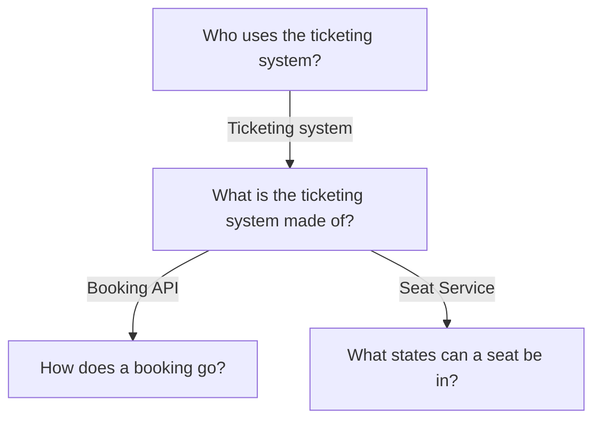
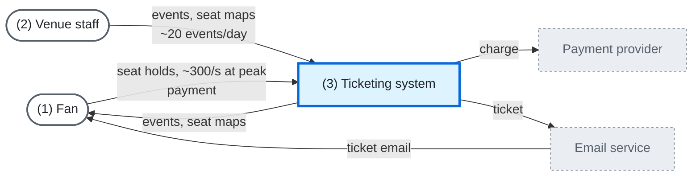
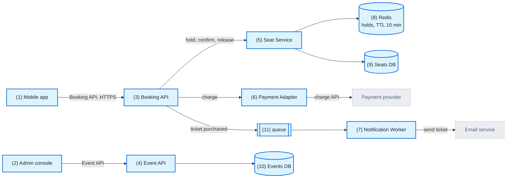
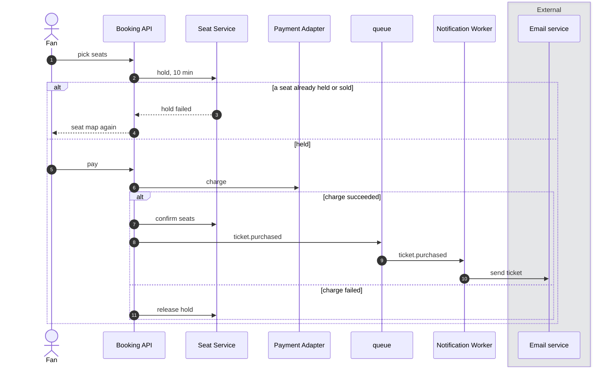
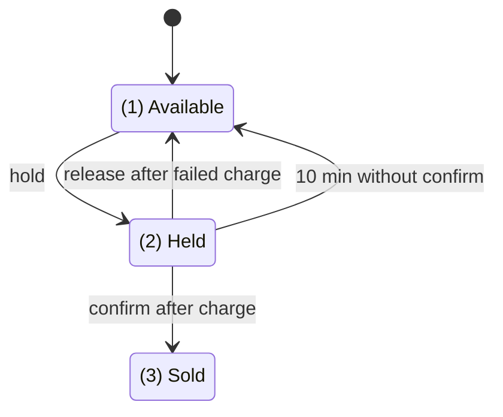

## Map

## Who uses the ticketing system?

1. [ticketing.md#L5](../examples/architecture-doc/ticketing.md?plain=1#L5)
2. [ticketing.md#L5](../examples/architecture-doc/ticketing.md?plain=1#L5)
3. [ticketing.md#L5](../examples/architecture-doc/ticketing.md?plain=1#L5)

## What is the ticketing system made of?

1. [ticketing.md#L11](../examples/architecture-doc/ticketing.md?plain=1#L11)
2. [ticketing.md#L12](../examples/architecture-doc/ticketing.md?plain=1#L12)
3. [ticketing.md#L13](../examples/architecture-doc/ticketing.md?plain=1#L13)
4. [ticketing.md#L14](../examples/architecture-doc/ticketing.md?plain=1#L14)
5. [ticketing.md#L15](../examples/architecture-doc/ticketing.md?plain=1#L15)
6. [ticketing.md#L16](../examples/architecture-doc/ticketing.md?plain=1#L16)
7. [ticketing.md#L17](../examples/architecture-doc/ticketing.md?plain=1#L17)
8. [ticketing.md#L15](../examples/architecture-doc/ticketing.md?plain=1#L15)
9. [ticketing.md#L15](../examples/architecture-doc/ticketing.md?plain=1#L15)
10. [ticketing.md#L14](../examples/architecture-doc/ticketing.md?plain=1#L14)
11. [ticketing.md#L17](../examples/architecture-doc/ticketing.md?plain=1#L17)

## How does a booking go?

1. [ticketing.md#L21](../examples/architecture-doc/ticketing.md?plain=1#L21)
2. [ticketing.md#L21](../examples/architecture-doc/ticketing.md?plain=1#L21)
3. [ticketing.md#L22](../examples/architecture-doc/ticketing.md?plain=1#L22)
4. [ticketing.md#L22](../examples/architecture-doc/ticketing.md?plain=1#L22)
5. [ticketing.md#L23](../examples/architecture-doc/ticketing.md?plain=1#L23)
6. [ticketing.md#L23](../examples/architecture-doc/ticketing.md?plain=1#L23)
7. [ticketing.md#L24](../examples/architecture-doc/ticketing.md?plain=1#L24)
8. [ticketing.md#L24](../examples/architecture-doc/ticketing.md?plain=1#L24)
9. [ticketing.md#L26](../examples/architecture-doc/ticketing.md?plain=1#L26)
10. [ticketing.md#L26](../examples/architecture-doc/ticketing.md?plain=1#L26)
11. [ticketing.md#L25](../examples/architecture-doc/ticketing.md?plain=1#L25)

## What states can a seat be in?

1. [ticketing.md#L28](../examples/architecture-doc/ticketing.md?plain=1#L28)
2. [ticketing.md#L21](../examples/architecture-doc/ticketing.md?plain=1#L21)
3. [ticketing.md#L24](../examples/architecture-doc/ticketing.md?plain=1#L24)
